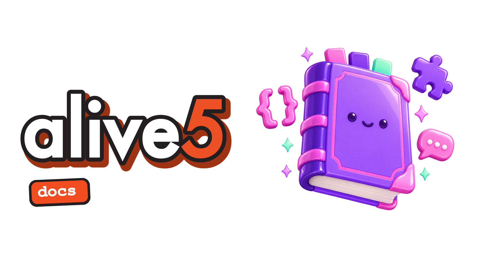
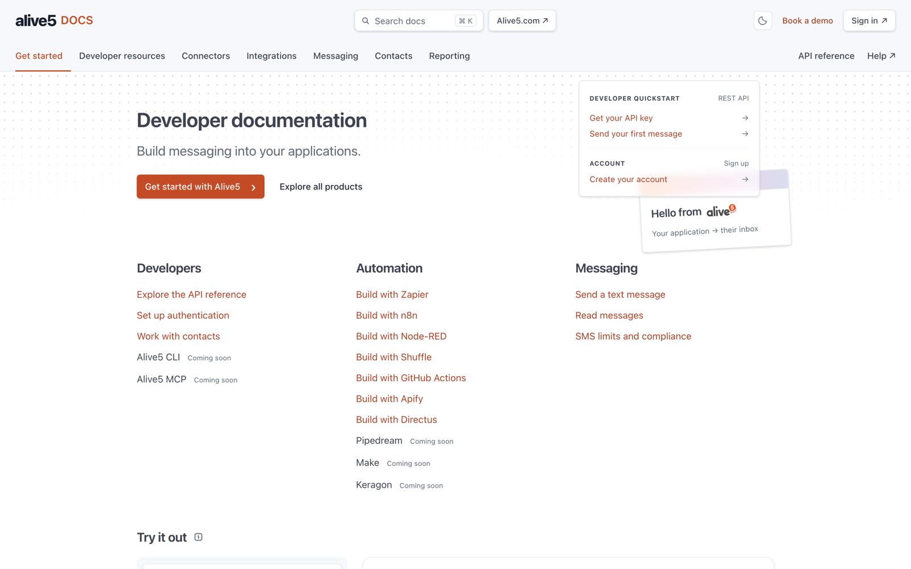
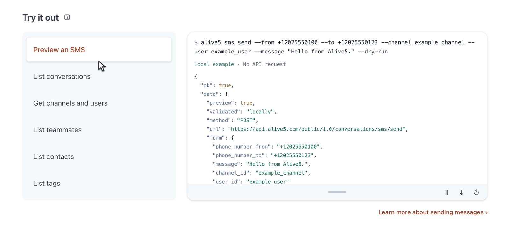
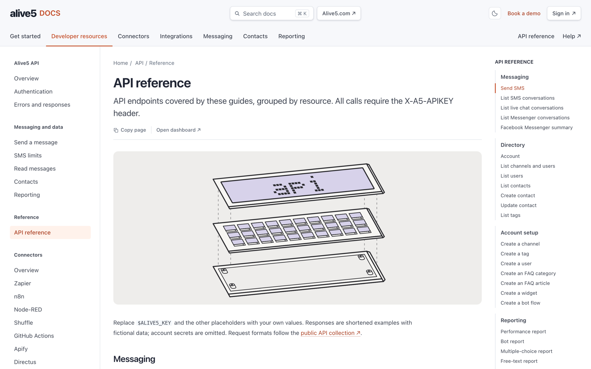
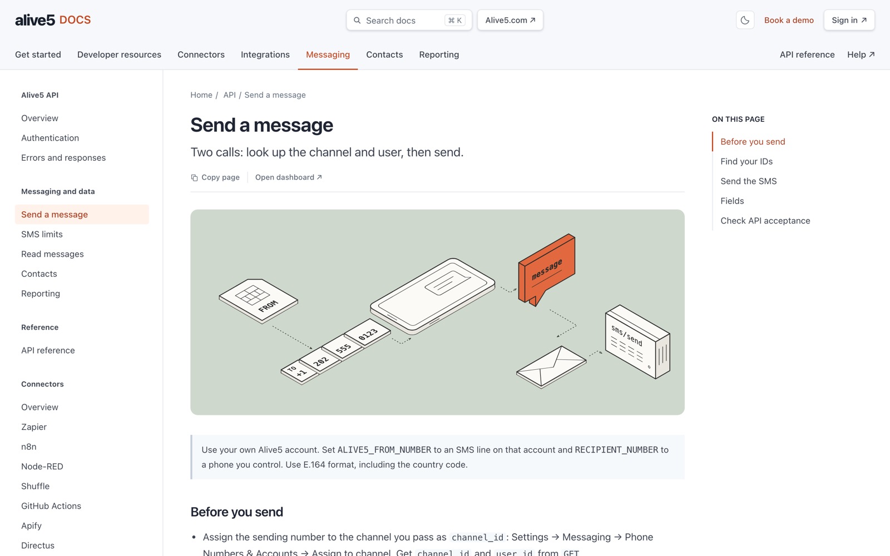
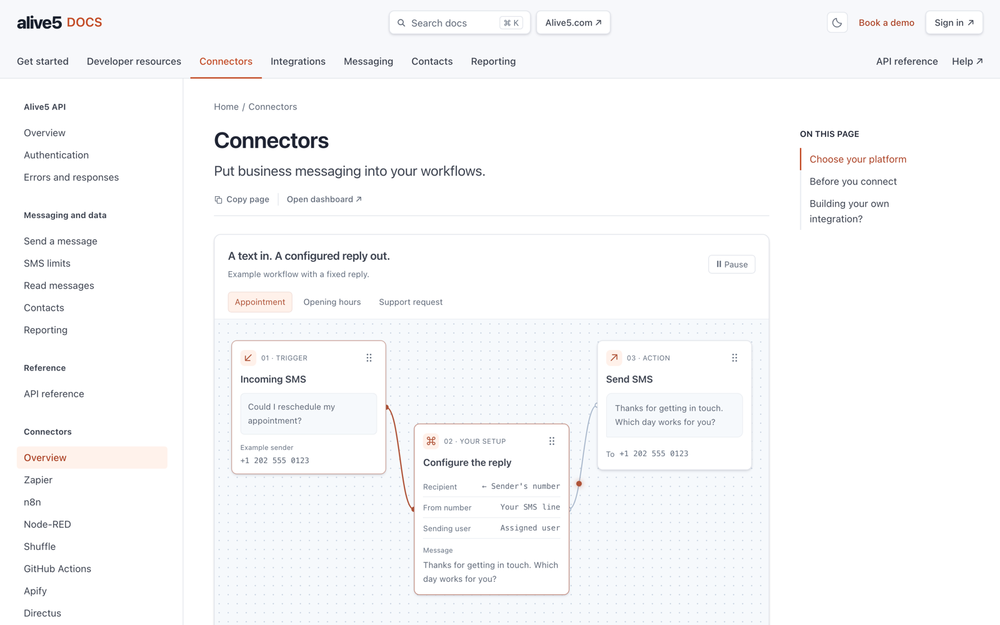
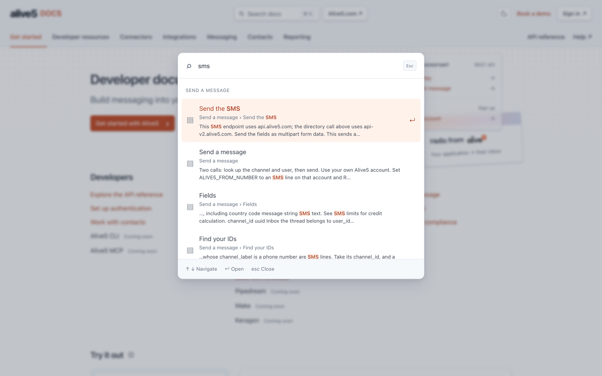

# Alive5 developer docs



Every Alive5 developer guide in one place: the REST API, connectors, chat widget, CRM integrations and SMS compliance.

## Live site

**[imraghavojha.github.io/alive5-docs](https://imraghavojha.github.io/alive5-docs/)**

## A look around





<table>
  <tr>
    <td></td>
    <td></td>
  </tr>
  <tr>
    <td></td>
    <td></td>
  </tr>
</table>

## Updating the CLI preview

Run `node scripts/sync-cli-art.mjs /path/to/alive5-cli` to refresh the shared wordmark renderer and mascot frames. The browser adapter uses the docs theme and keeps the preview local to the page.

## Editing through Notion

The 21 guides can be edited in Notion. `api/reference.html` remains Postman/repo-owned; `404.html`, layouts, styles, and interactive widgets stay in the repo. The website still serves plain HTML, CSS, and JavaScript.

Use Node.js 22 or later. Create an empty Notion root page and share it with an integration with read, insert, and update content permissions. Set `NOTION_TOKEN` and `NOTION_ROOT_PAGE_ID` in your shell, then run:

```sh
cd notion
npm ci
npx playwright install chromium
npm run seed
npm run build
npm run verify -- --live
```

Seed creates section pages and their articles in navigation order. It writes page/block IDs and layout bindings to `notion/map.json` and `notion/templates.json`, never into visible Notion content. Commit both files and the generated site. Seed can resume an interrupted import; by default it skips completed articles. Use build for subsequent syncs. For a previously seeded workspace, `npm run seed -- --update-editor` applies the readable homepage and widget-callout layout to the same pages. It refuses unsynced edits, resumes interruptions, and is a no-op after completion.

Set the same two values as repository Actions secrets. **Sync Notion docs** is scheduled every 15 minutes, but GitHub often runs it hours apart. Use **Run workflow** on `main` to publish immediately. The workflow commits changed output and requests a Pages build explicitly because pushes using `GITHUB_TOKEN` do not trigger Pages builds. Every run checks the latest Pages build against `main` and retries stale or failed builds, even without content changes. Pages can remain configured for `main` / root. [GitHub token documentation](https://docs.github.com/en/actions/concepts/security/github_token)

To move workspaces, share a new empty page with an integration with read, insert, and update content permissions.
From `notion/` with a clean checkout at the latest `origin/main` and `gh` authenticated, run `NOTION_TOKEN=... npm run repoint -- '<new page URL or ID>'`.
The script seeds, builds, and verifies locally, then disables **Sync Notion docs** and waits for in-progress runs. It commits and pushes the refreshed map, templates, and generated output to `main` before setting `NOTION_TOKEN` and then `NOTION_ROOT_PAGE_ID`. It reports each successful secret update and attempts to re-enable the workflow even if a later step fails.

Edit ordinary headings, paragraphs, lists, tables, code, and images. Adjacent code blocks with captions become labeled tabs. Keep the information callouts describing repo-owned interactive examples where those examples belong. The Reference section links directly to the official Postman collection. [Notion blocks](https://developers.notion.com/reference/block) cannot carry the site's CSS layouts and JavaScript behavior, so repo templates preserve those. Existing images use published asset URLs; seed uploads local illustration assets through the file-upload API. Notion-uploaded images are copied locally during build to avoid expiring links. Unsupported blocks produce a warning and a safe link/text fallback, or are skipped. Sync aborts if an existing article has no meaningful rendered content, the homepage would be deleted, or more than three pages would be deleted at once. Empty new pages are skipped until they have content. Deleted page URLs stay reserved for restoration.

For offline checks, run `npm test` and `npm run verify` inside `notion/`. Verification rebuilds from an API-shaped tree, compares DOM text and structure for every article, and checks that the search index matches the published version. It also checks interactions on desktop (1440 px) and mobile (390 px). Add `--live` to compare the site against a fresh Notion API read.

## Syncing the API reference from Postman

- Set the repository Actions variable `POSTMAN_REFERENCE_SYNC` to `true` to enable the sync.
- Postman decides which endpoints exist. New routes get generated entries marked `data-postman` that the sync regenerates or removes automatically.
- Hand-written entries stay as written. Drift appears as warnings in the Actions run and in `node scripts/sync-postman-reference.mjs --check`, which exits 1 on drift.
- Delete `data-postman` to adopt and hand-edit a generated entry.
- Optionally set the repository Actions variable `POSTMAN_COLLECTION_URL` to use a different feed.
- After running `node scripts/sync-postman-reference.mjs` locally, rebuild the search index with `node scripts/build-search-index.mjs`.
