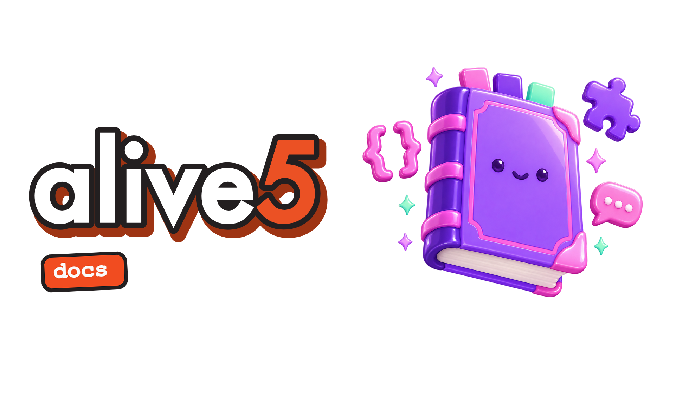
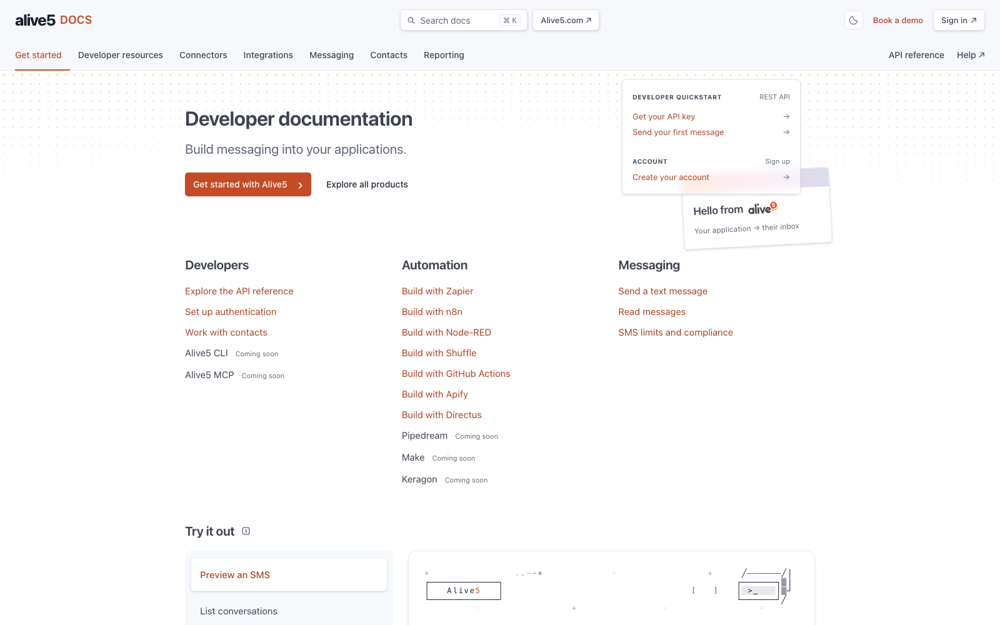
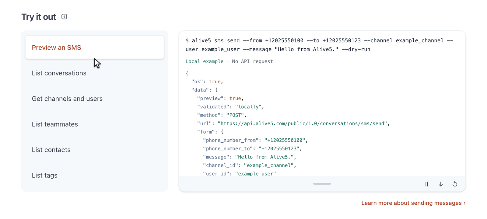
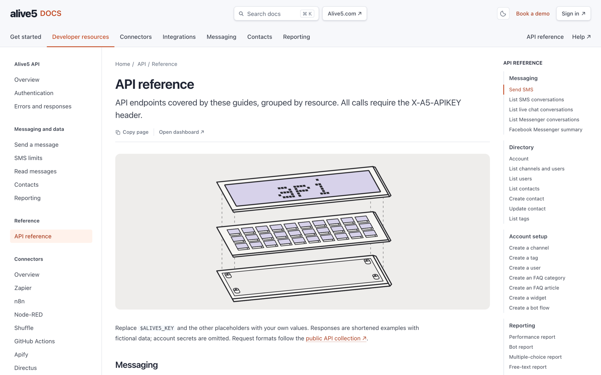
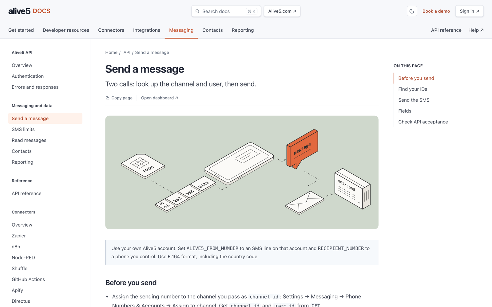
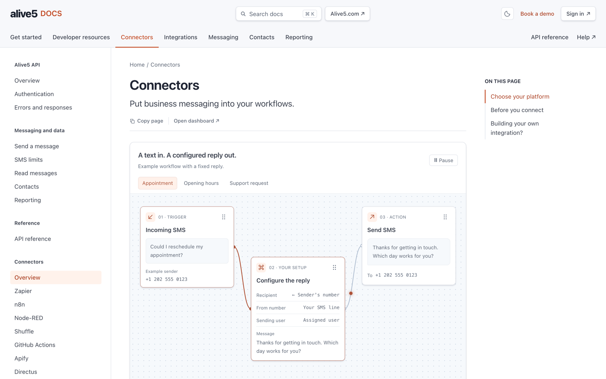
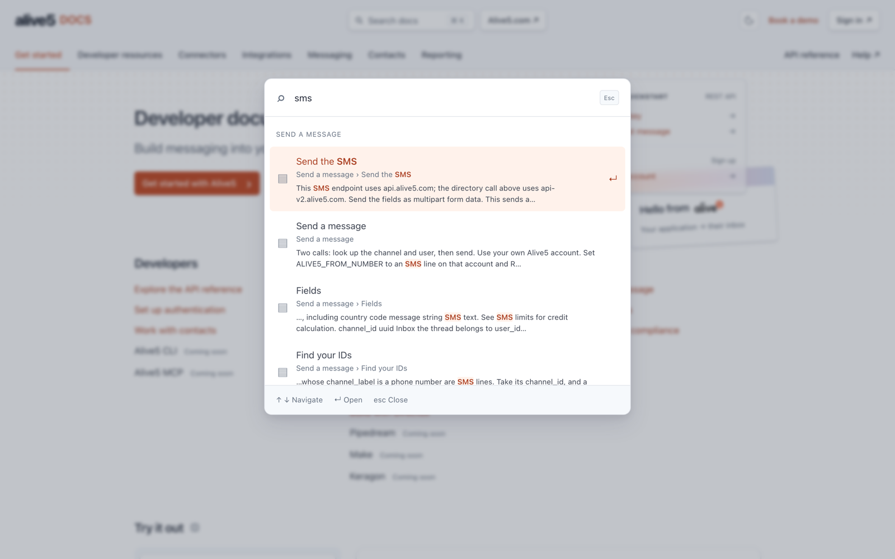

# Alive5 developer docs

Every Alive5 developer guide in one place: the REST API, connectors, chat widget, CRM integrations and SMS compliance.

## Live site

**[imraghavojha.github.io/alive5-docs](https://imraghavojha.github.io/alive5-docs/)**

## A look around

<table>
  <tr>
    <td></td>
    <td></td>
  </tr>
  <tr>
    <td></td>
    <td></td>
  </tr>
</table>

## Updating the CLI preview

Run `node scripts/sync-cli-art.mjs /path/to/alive5-cli` to refresh the shared wordmark renderer and mascot frames. The browser adapter uses the docs theme and keeps the preview local to the page.
