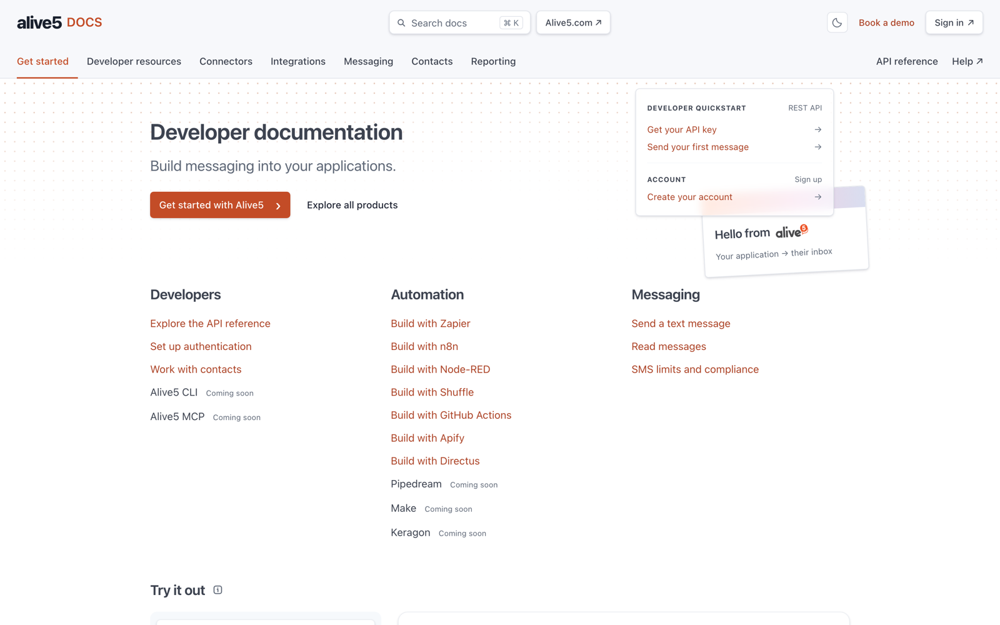
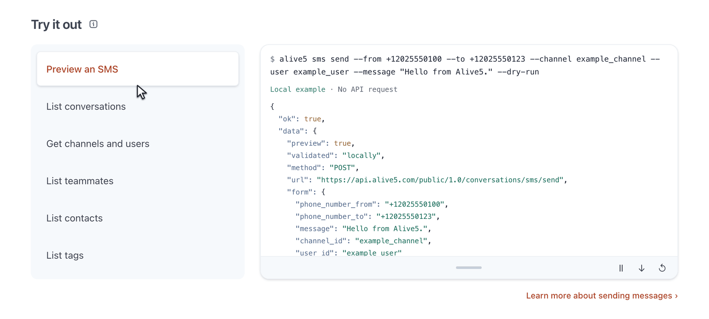
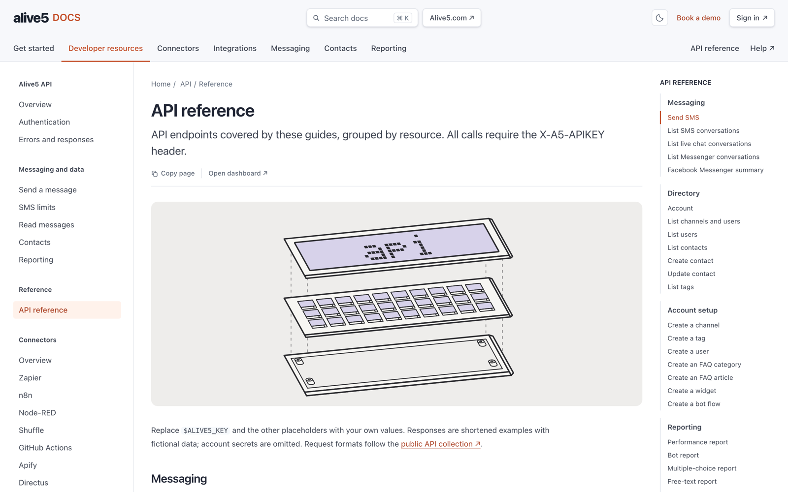
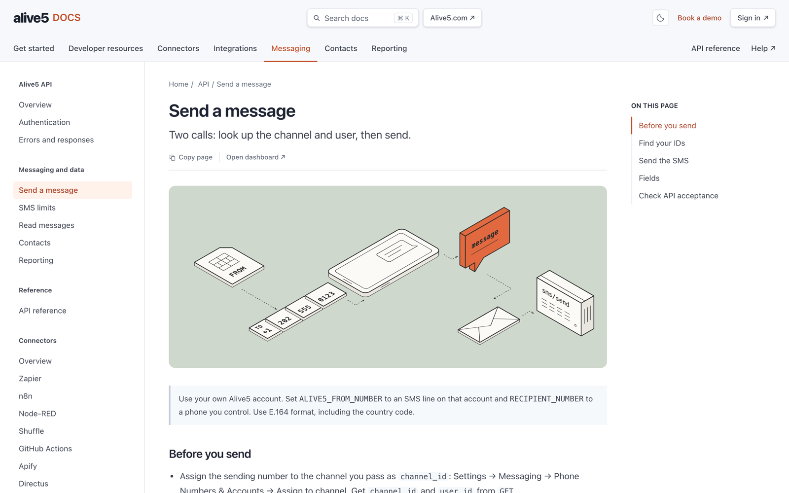
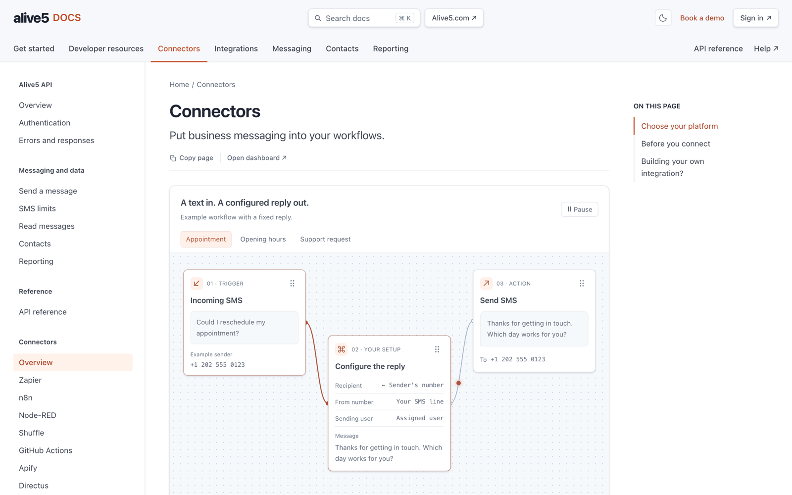
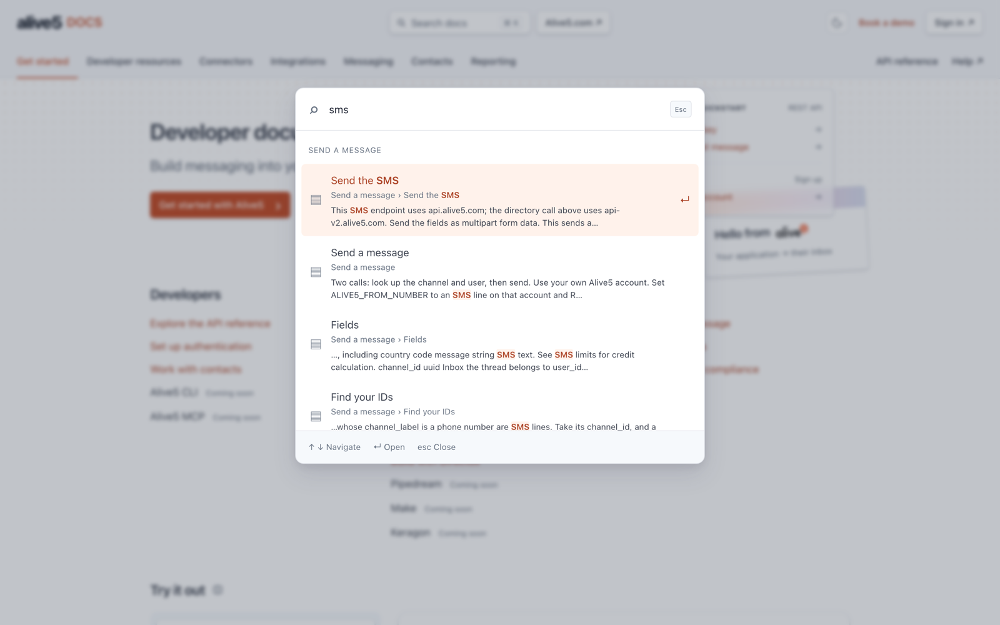

# Alive5 developer docs


Every Alive5 developer guide in one place: the REST API, connectors, chat widget, CRM integrations and SMS compliance.

## Live site

**[imraghavojha.github.io/alive5-docs](https://imraghavojha.github.io/alive5-docs/)**

## A look around





<table>
  <tr>
    <td></td>
    <td></td>
  </tr>
  <tr>
    <td></td>
    <td></td>
  </tr>
</table>

## Updating the CLI preview

Run `node scripts/sync-cli-art.mjs /path/to/alive5-cli` to refresh the shared wordmark renderer and mascot frames. The browser adapter uses the docs theme and keeps the preview local to the page.

## Editing through Notion

The 21 guides can be edited in Notion. `api/reference.html` remains Postman/repo-owned; `404.html`, layouts, styles, and interactive widgets stay in the repo. The website still serves plain HTML, CSS, and JavaScript.

Create an empty Notion root page and share it with an integration with read, insert, and update content permissions. Set `NOTION_TOKEN` and `NOTION_ROOT_PAGE_ID` in your shell, then run:

```sh
cd notion
npm ci
npx playwright install chromium
npm run seed
npm run build
npm run verify -- --live
```

Seed creates section pages and their articles in navigation order. It writes page/block IDs and layout bindings to `notion/map.json` and `notion/templates.json`, never into visible Notion content. Commit both files and the generated site. Seed can resume an interrupted import; it skips completed articles and never overwrites their edits. Use build for subsequent syncs.

Set the same two values as repository Actions secrets. **Sync Notion docs** runs every 15 minutes or through **Run workflow**, committing only changed output to `main`. It explicitly requests a Pages build because [pushes using `GITHUB_TOKEN` do not trigger Pages builds](https://docs.github.com/en/actions/concepts/security/github_token). Every run checks the latest Pages build against `main` and retries stale or failed builds, even without content changes. Pages can remain configured for `main` / root.

To move workspaces, first build any pending edits from the old workspace. Change only the token and root page ID, run seed against an empty shared root, then build and verify again. Commit the refreshed map/templates and update the two Actions secrets. Existing article URLs stay stable; new pages receive collision-safe slugs from their titles. Section and article order drives navigation; deleting an article removes its HTML and search entry.

Edit ordinary headings, paragraphs, lists, tables, code, and images. Adjacent code blocks with captions become labeled tabs. Keep the small `⟦…⟧` widget callouts where the corresponding interactive example belongs. [Notion blocks](https://developers.notion.com/reference/block) cannot carry the site's CSS layouts and JavaScript behavior, so repo templates preserve those. Existing images use published asset URLs; seed uploads local illustration assets through the file-upload API. Notion-uploaded images are copied locally during build to avoid expiring links. Unsupported blocks produce a warning and a safe link/text fallback, or are skipped. Sync aborts if an existing article has no meaningful rendered content, the homepage would be deleted, or more than three pages would be deleted at once. Empty new pages are skipped until they have content. Deleted page URLs stay reserved for restoration.

For offline checks, run `npm test` and `npm run verify` inside `notion/`. Verification creates an API-shaped tree from current HTML, compares all article DOM text/structure and search output, checks full-page screenshot pairs at 1440px and 390px, and exercises tabs, copying, theme, search, menus, and widgets. Temporary pages, screenshots, and pixel diffs are removed automatically. `--live` additionally checks the site against a fresh Notion API read; it does not edit Notion.
